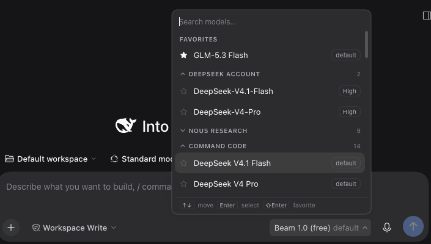
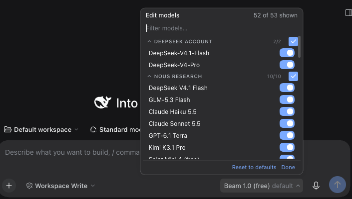
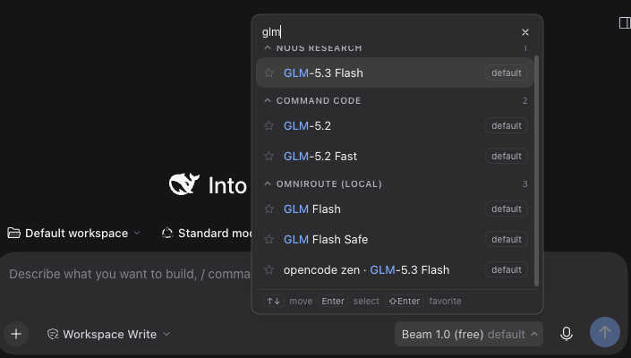
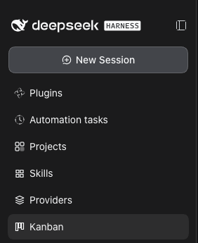
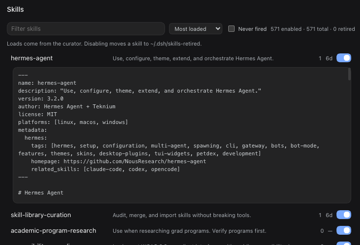
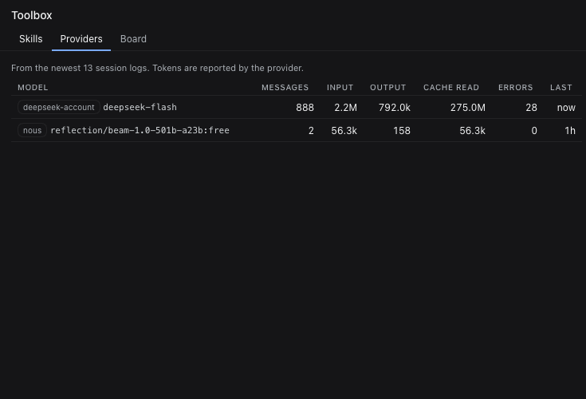
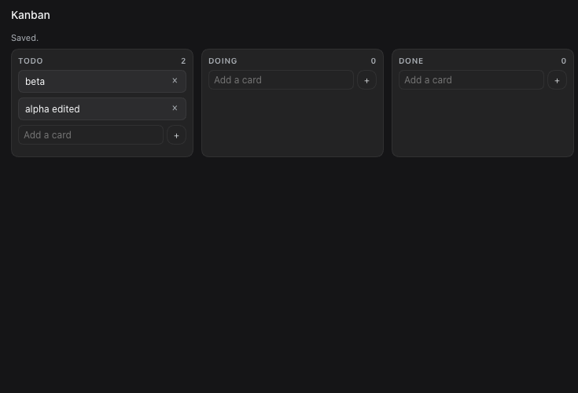
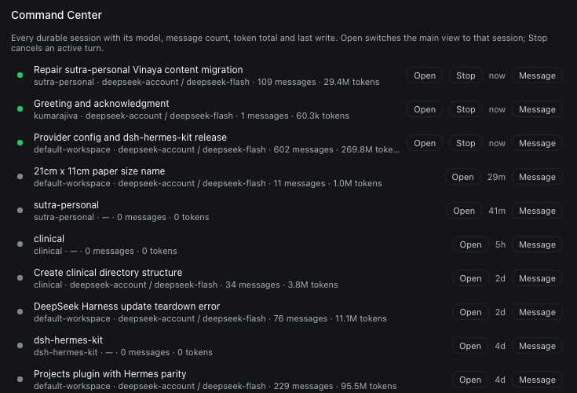

# dsh-hermes-kit

Three [DeepSeek Harness](https://github.com/deepseek-ai/deepseek-harness) plugins that replace weak surfaces with Hermes desktop's versions — a searchable model picker with favorites and per-model reasoning, a Projects view, and a Toolbox panel (skills, provider health, kanban) — plus the CLI kit the harness was missing: durable memory, restore-safe checkpoints, and evidence about which skills actually fire.



## Install

```sh
git clone https://github.com/colerehbein/dsh-hermes-kit.git
cd dsh-hermes-kit
./install.sh
```

One command. It copies each plugin into your DSH profile, registers them (dependency, bundle entry, `node_modules` link), and installs the CLIs into `~/.dsh/bin` with their three skills. Quit and reopen DeepSeek Harness — the Host composes its plugin graph at boot, so a page reload alone is not enough — and the picker is there.

```sh
./install.sh --dry-run        # print every change, touch nothing
./install.sh --profile web    # target a named profile (default: most recently used)
./install.sh --no-tools       # plugins only, skip the CLIs
```

Needs `bash`, `python3`, and an existing DSH profile.

## What's in the kit

### Plugins

| Plugin | What it does |
| --- | --- |
| **Model picker** — [`packages/model-picker`](packages/model-picker) | Replaces the composer's model seat: search with match highlighting, favorites, collapsible provider groups, per-model reasoning levels, and an **Edit models** dialog that decides which models appear at all. |
| **Projects page** — [`packages/projects-page`](packages/projects-page) | A read-only Projects panel: registry roster, open `TODO.md` items, subfolders, newest sessions, session hover marks. |
| **Skills · Providers · Kanban · Command Center** — [`packages/toolbox`](packages/toolbox) | Four sidebar panels: skills manager (curator load counts, enable/disable), provider health (tokens, errors, last used per model), a kanban board, and a session dashboard. |

### CLIs — [`tools/dsh-kit`](tools/dsh-kit)

| Command | What it does |
| --- | --- |
| `mem` | SQLite+FTS5 memory across sessions: `add`, `search`, `brief`, `forget`. `install-brief` feeds the brief into `~/.dsh/AGENTS.md`, so every new session starts with it. |
| `ckpt` | Shadow-git snapshots stored outside the workspace — `git reset --hard` cannot destroy them. |
| `curator` | Reads `~/.dsh/sessions/**/*.jsonl.zstd` and reports skill loads, tool error rates, and skills that never fire. |
| `proj` | Imports a Hermes `projects.db` into `~/.dsh/projects/projects.json` — the registry the Projects page reads. |
| `extras/skill-audit` | Inventories a skill library, finds duplicate and broken entries, plans a retirement with a dry run. |

Three skills (`dsh-memory`, `dsh-checkpoints`, `dsh-curator`) ship with the CLIs, so the agent knows when to reach for each tool.

## The model picker



- **One panel, not drilled menus.** Search matches model names by ordered subsequence and highlights the hit; providers stay grouped with live counts.
- **Favorites** sit above the providers, starred with the star on any row (or `Shift+Enter`). A favorite is exempt from the visibility filter and is never listed twice.
- **Provider groups collapse** and remember it.
- **Reasoning levels** are one click from the row: the chip opens `default / off / low / medium / high` for that exact model, and picking one commits model + effort.
- **Edit models…** opens a visibility editor: a switch per model, a provider master switch with an indeterminate state, `on/total` counters, a filter, and *Reset to defaults*.
- **Visibility rules** follow Hermes: never-curated means everything; hiding a provider's last model records a hide-all sentinel; models that arrive later default to visible; `Reset` clears both keys.
- **Keyboard**: `↑`/`↓` move the highlight, `Enter` selects, `Shift+Enter` stars, `Esc` leaves the editor or closes. Focus stays in the search field.

The picker shadows the stock `conversation.input.model` occupant at `priority: -1` (a single slot renders the lowest priority and requires distinct priorities) and reuses the same per-session `modelDirectories` service, so model switches keep DSH's durable behaviour.



## Skills, Providers, Kanban, Command Center

Four separate sidebar panels from one package.



**Skills** — every skill with its curator load count and last-seen time, sortable by loads/recent/name, a "never fired" filter, duplicate-name badges, and a switch. Disabling moves the skill to `~/.dsh/skills-retired` and back, because a leading dot does not hide a skill from DSH's catalogue.



**Providers** — per provider/model totals from the newest 40 session logs: messages, input/output/cache tokens, mean response time, errors, last used — plus a **Test** button that makes one timed one-token call to that exact route.



**Kanban** — three columns persisted at `~/.dsh/toolbox/board.json`: drag a card to any position (not just the column end), double-click to edit it in place, add and remove. The agent gets a `kanban` tool with the same actions, so it can read and move the board too.



**Command Center** — every durable session with its status, model, message count, token total and last write. **Open** switches the main view to that session, **Message** queues a prompt (steers it when the session is running), and **Stop** cancels an active turn.



## The Projects page

Reads `~/.dsh/projects/projects.json` (populate it with `proj import` or `proj adopt <path>`), each project's `TODO.md`, its top-level folders, and the session index. Registers a sidebar panel, a session-row hover mark, and a main panel; the Host half exposes three read-only `/api/projects-page/*` routes. No writes, no personal roster in the package.

## Provider recipes

[`providers/providers.example.yml`](providers/providers.example.yml) carries the 51-model, 4-route setup these plugins were built against: Nous Research, Command Code (chat **and** its Anthropic Messages-only Claude models), and a local OmniRoute. Keys stay in DSH's credential store; the file names references only.

## Manual install

Prefer the plugin manager? Each package installs on its own:

```text
plugin_manager install_bundle file:$PWD/packages/model-picker
plugin_manager install_bundle file:$PWD/packages/projects-page
plugin_manager install_bundle file:$PWD/packages/toolbox
```

The CLIs are independent of the plugins: `./tools/dsh-kit/install.sh`.

If you already run an older copy of either plugin, disable it first — two occupants of the model seat at the same priority refuse to register, and two Projects panels both appear in the sidebar.

## Uninstall

```sh
# plugins: remove the two entries from <profile>/package.json (dependencies + bundles)
rm -rf ~/.dsh/profiles/<profile>/created-plugins/model-picker \
       ~/.dsh/profiles/<profile>/created-plugins/projects-page
rm ~/.dsh/profiles/<profile>/node_modules/@dsh-local/{hermes-model-picker,projects-page}

# CLIs
rm ~/.dsh/bin/{mem,ckpt,curator,proj,import-memory,install-brief}
rm -rf ~/.dsh/skills/{dsh-memory,dsh-checkpoints,dsh-curator}
```

Data stays under `~/.dsh/{memory,curator,checkpoints,projects}`.

## Compatibility

Client plugins against DSH's internal slot and service APIs (`0.2.x`): `ctx.slots`, `ctx.locale`, `ctx.modelDirectories`, and the `conversation.input.model` contract. An upstream slot-contract change can break them; the kit is versioned as a whole.

## License

MIT — see [LICENSE](LICENSE).
